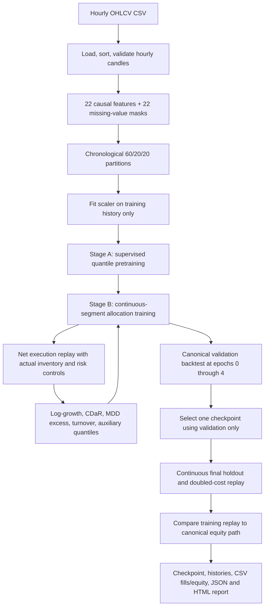
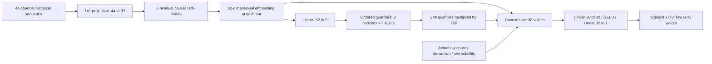

# BTC/Cash TCN: Training Pipeline and Implementation Reference

This document describes the **implemented first version**, including its exact tensor layouts, losses, execution rules, defaults, and saved artifacts. It is a companion to [TCN_TRADING.md](TCN_TRADING.md). Core model values are checked against the source and the completed `results/tcn_btc_v1` experiment. TensorBoard monitoring was added subsequently; the original v1 artifacts remain unchanged.

The system is a **single-asset, long-only BTC/cash model**. It combines supervised return-quantile forecasting with state-conditioned allocation learned through a piecewise differentiable trading replay. The forecast target is a future return; the trading output is a target BTC allocation. Net account growth and path-dependent drawdown determine the allocation training objective.

## Contents

1. [Pipeline overview](#1-pipeline-overview)
2. [Raw input data](#2-raw-input-data)
3. [Features and normalization](#3-features-and-normalization)
4. [Labels, partitions, and sample counts](#4-labels-partitions-and-sample-counts)
5. [Network structure and parameter counts](#5-network-structure-and-parameter-counts)
6. [Stage A: quantile pretraining](#6-stage-a-quantile-pretraining)
7. [Stage B: allocation training](#7-stage-b-allocation-training)
8. [Exact loss definitions](#8-exact-loss-definitions)
9. [From network output to an executable order](#9-from-network-output-to-an-executable-order)
10. [Execution accounting and protective exits](#10-execution-accounting-and-protective-exits)
11. [Validation and checkpoint selection](#11-validation-and-checkpoint-selection)
12. [Output formats and artifact schemas](#12-output-formats-and-artifact-schemas)
13. [Complete configuration reference](#13-complete-configuration-reference)
14. [Reproduction and inference](#14-reproduction-and-inference)
15. [Results, interpretation, and implementation limits](#15-results-interpretation-and-implementation-limits)
16. [Source map and research references](#16-source-map-and-research-references)
17. [TensorBoard monitoring](#17-tensorboard-monitoring)

## 1. Pipeline overview



The two training stages have different optimization targets:

| Stage | Learning signal | Samples | Parameters receiving gradients |
|---|---|---|---|
| A: pretraining | Pinball loss for future executable returns | Historical windows with future labels | Input projection, TCN blocks, quantile head |
| B: policy tuning | Realized simulated account growth and risk, plus pinball auxiliary loss | Chronological trading segments | Encoder, quantile head, allocation head, where their active computation paths carry gradients |

No optimizer runs on validation or holdout data. The allocation head is not trained by Stage A because it is not called in that stage. Stage B uses a newly created optimizer; Stage A's optimizer moments are not carried forward.

## 2. Raw input data

### 2.1 CSV interface

Required columns:

| Column | Interpretation | Requirements |
|---|---|---|
| `timestamp` | Candle opening timestamp | Parseable, unique, continuous hourly cadence after sorting |
| `open` | Opening BTC price | Finite and positive |
| `high` | Highest price within the candle | At least `max(open, close, low)` |
| `low` | Lowest price within the candle | At most `min(open, close, high)` |
| `close` | Closing BTC price | Finite and positive |
| `volume` | Exchange-reported candle volume | Finite and nonnegative, with consistent units across the dataset |

Example format; these rows are illustrative:

```csv
timestamp,open,high,low,close,volume
2025-01-01 00:00:00,95000,95400,94800,95200,1000
2025-01-01 01:00:00,95200,95700,95000,95500,1200
```

`load_ohlcv()` reads the CSV, parses timestamps and numeric values, rejects duplicates/nonfinite values, keeps only the five OHLCV columns, sorts by timestamp, and returns:

```text
pandas.DataFrame
index: DatetimeIndex, length N
columns: [open, high, low, close, volume]
```

Extra CSV columns such as quote volume, taker volume, trade count and close time are discarded. They are not current model inputs. Timestamp order can be corrected by the loader; missing hourly candles are rejected by `validate_candles()`, rather than resampled or invented.

The code does not convert timezones. Calendar features and daily trade-counter resets use the supplied index's hour/date. The cached Binance timestamps are represented as timezone-naive UTC; maintain that convention when reproducing this experiment. Use only completed candles: a close-derived decision assumes the whole candle is observable.

### 2.2 Actual dataset

The completed experiment used `data/historical/btc_1h_730d.csv`:

| Property | Value |
|---|---|
| Raw rows | 17,512 |
| Frequency | 1 hour |
| First timestamp | 2024-10-07 12:00:00 |
| Last timestamp | 2026-10-07 03:00:00 |
| Asset | BTC |
| Account currency | Quote-currency cash, treated as having zero yield |

The data hash is stored in `manifest.json` and `report.json`. The historical file had already been used in prior strategy research, so this is retrospective validation.

## 3. Features and normalization

### 3.1 Exact feature order and formulas

Let $O_t,H_t,L_t,C_t,U_t$ denote opening/high/low/closing price and volume. Let $r_t=\log(C_t/C_{t-1})$. Rolling standard deviations use pandas' default sample convention, `ddof=1`.

There are **22 numerical features**, in this exact order:

| Index | Feature | Formula / implementation |
|---:|---|---|
| 0 | `return_1` | $\log(C_t/C_{t-1})$ |
| 1 | `return_4` | $\log(C_t/C_{t-4})$ |
| 2 | `return_12` | $\log(C_t/C_{t-12})$ |
| 3 | `return_24` | $\log(C_t/C_{t-24})$ |
| 4 | `return_72` | $\log(C_t/C_{t-72})$ |
| 5 | `return_168` | $\log(C_t/C_{t-168})$ |
| 6 | `volatility_12` | Rolling standard deviation of $r_t$, 12 bars |
| 7 | `ma_deviation_12` | $C_t/\operatorname{SMA}_{12}(C)_t-1$ |
| 8 | `volatility_24` | Rolling standard deviation of $r_t$, 24 bars |
| 9 | `ma_deviation_24` | $C_t/\operatorname{SMA}_{24}(C)_t-1$ |
| 10 | `volatility_72` | Rolling standard deviation of $r_t$, 72 bars |
| 11 | `ma_deviation_72` | $C_t/\operatorname{SMA}_{72}(C)_t-1$ |
| 12 | `range` | $(H_t-L_t)/C_t$ |
| 13 | `body` | $(C_t-O_t)/O_t$ |
| 14 | `upper_wick` | $(H_t-\max(O_t,C_t))/C_t$ |
| 15 | `lower_wick` | $(\min(O_t,C_t)-L_t)/C_t$ |
| 16 | `log_volume_change` | $\log(1+U_t)-\log(1+U_{t-1})$ |
| 17 | `volume_ratio` | $U_t/\operatorname{SMA}_{24}(U)_t-1$; zero rolling mean becomes missing |
| 18 | `rsi` | $G_t/(G_t+A_t)$, using 14-bar rolling average positive/negative price changes |
| 19 | `atr_ratio` | 14-bar rolling mean true range divided by $C_t$ |
| 20 | `hour_sin` | $\sin(2\pi\operatorname{hour}(t)/24)$ |
| 21 | `hour_cos` | $\cos(2\pi\operatorname{hour}(t)/24)$ |

For RSI:

$$
\Delta_t=C_t-C_{t-1},\quad
G_t=\operatorname{SMA}_{14}(\max(\Delta_t,0)),\quad
A_t=\operatorname{SMA}_{14}(\max(-\Delta_t,0)).
$$

The RSI feature is on a **0-to-1 scale**, not 0-to-100. Undefined RSI is filled with neutral `0.5` before missing masks are generated. Consequently, neutral-filled RSI is not marked missing.

For ATR:

$$
TR_t=\max\{H_t-L_t,\ |H_t-C_{t-1}|,\ |L_t-C_{t-1}|\}.
$$

This implementation uses a simple rolling mean of true range, not Wilder's recursive smoothing. Features use only candles through $t$. Rolling windows include the current completed candle.

### 3.2 Fit the scaler only on training history

For each numerical feature $j$, the implementation fits:

```python
mean = raw_features.iloc[168:train_end].mean()
scale = raw_features.iloc[168:train_end].std()
```

Pandas ignores missing values when computing these statistics. A nonfinite or nearly zero scale (`<=1e-8`) is replaced with `1.0`; nonfinite means are replaced with zero. The scaler uses training observations including the last training bars that are excluded from forecast labels. Those bars are available training history and do not introduce validation information.

Transformation:

$$
\widetilde{x}_{t,j}=\operatorname{clip}\left(\frac{x_{t,j}-\mu_j}{s_j},-10,10\right).
$$

If a raw feature is nonfinite, its transformed numerical value becomes zero and its binary missing mask becomes one. The 22 mask channels are appended **after all 22 numerical channels**, in the same feature order:

```text
[22 standardized/clipped features, 22 binary missing masks]
```

Masks are not standardized. Undefined feature values are not filled using future observations. The `mean` and `scale` arrays both have shape `[22]`; normalized model input has shape `[N, 44]` and dtype `float32`.

### 3.3 Prepared data interface

`prepare_data(frame, config)` returns a `PreparedData` object:

| Field | Type / shape | Use |
|---|---|---|
| `frame` | OHLCV DataFrame, `[N,5]` | Actual execution prices and timestamps |
| `features` | `float32 ndarray [N,44]` | Encoder inputs |
| `labels` | `float32 ndarray [N,3]` | Returns for horizons `[4,12,24]` |
| `mean`, `scale` | Arrays `[22]` | Stored normalization |
| `feature_names` | List of 44 strings | Schema and channel ordering |
| `train_indices` | Integer array | Decision closes with complete training labels |
| `validation_indices` | Integer array | Label-safe validation indices used by TensorBoard diagnostic losses; not used to rank checkpoints |
| `train_end`, `validation_end`, `test_start` | Integers | Partition boundaries |
| `volatility` | `float32 ndarray [N]` | **Unstandardized** hourly-return 24-bar volatility for account state and risk scaling |

The normalized `volatility_24` feature and raw `volatility` account input are different representations of the same underlying statistic.

## 4. Labels, partitions, and sample counts

### 4.1 Forecast labels match observable decision timing

For a decision made at candle $t$ close and horizon $h$:

$$
y_{t,h}=\frac{C_{t+h}}{O_{t+1}}-1,\qquad h\in\{4,12,24\}.
$$

Example: the 4-hour label enters at the next candle's open and exits at the fourth future candle's close. It does not assume an entry at the current observed close.

Labels are **simple gross asset returns**, before commission, slippage or position sizing. They are not log returns, net portfolio returns, or manually generated buy/sell labels. Transaction costs enter the account replay and predictive trading gate separately.

Label layout:

```text
labels[t] = [return_4h, return_12h, return_24h]
```

The last 24 raw dataset rows do not have all three future labels. The feature encoder can still generate causal predictions there, but those unavailable labels cannot be used for supervised training.

### 4.2 Chronological split and purge

With $N$ rows:

```text
train_end      = int(N * 0.6)
validation_end = int(N * 0.8)
train          = [0, train_end)
validation     = [train_end, validation_end)
holdout        = [validation_end, N)
```

Intervals are half-open. Warmup for label-bearing training windows is:

```text
warmup = 168 + lookback - 1 = 335
train_indices = arange(335, train_end - 24)
validation_indices = arange(train_end, validation_end - 24)
```

For a retained training decision, $t+24<\text{train_end}$. This purges any label that would read validation prices. The analogous purge applies to validation label indices. Trading validation itself evaluates the entire validation partition, because it uses observed prices and predictions, not future-label loss.

Historical context is allowed to cross a split boundary **backward** to warm the encoder. Future prices do not cross a boundary into training labels or normalization.

### 4.3 Actual first-experiment sizes

| Item | Count / indices |
|---|---|
| Training raw candles | 10,507; indices `0..10506` |
| Validation candles | 3,502; indices `10507..14008` |
| Holdout candles | 3,503; indices `14009..17511` |
| Label-safe training decisions | 10,148; indices `335..10482` |
| Pretraining sampled decisions | 846; training indices sampled every 12 bars |
| First/last pretraining sampled index | `335` / `10475` |
| Pretraining batches per epoch | 53: 52 batches of 16 and one of 14 |
| Pretraining updates per seed | 318: `6 * 53` |
| Policy segments per epoch | 22: 21 segments of 480 bars, one of 68 bars |
| Policy updates per seed | 88: `4 * 22` |
| Validation checkpoint candidates per seed | 5: policy epochs `0,1,2,3,4` |

The sampler stride is currently hardcoded to 12; changing `rebalance_bars` does not change the pretraining sampling stride. Segment tails shorter than 48 bars are discarded. The actual 68-bar tail is retained.

## 5. Network structure and parameter counts

### 5.1 Shapes and forward path

Let $B$ be batch size and $T$ sequence length. Default $B=16$, window $T=168$, hidden width $D=32$.

```text
features                       [B,44,T]
  Conv1d(44,32,kernel=1)     -> [B,32,T]
  6 causal residual blocks  -> [B,32,T]
  transpose                 -> [B,T,32] = encoded
  Linear(32,9)              -> [B,T,9]
  reshape                   -> [B,T,3,3] = raw quantile parameters
  ordered transformation    -> [B,T,3,3] = return quantiles
```

The first three-way axis is horizon order `[4h,12h,24h]`. The last axis of **returned** quantiles is probability order `[q10,q50,q90]`.



### 5.2 Residual causal block

Each block uses two `Conv1d(32,32,kernel_size=2,dilation=d)` operations. Each convolution is preceded by **left-only padding of `d` positions**, then GELU and dropout:

$$
u=\operatorname{Dropout}(\operatorname{GELU}(\operatorname{Conv}_1(\operatorname{LeftPad}(x,d)))),
$$

$$
f(x)=x+\operatorname{Dropout}(\operatorname{GELU}(\operatorname{Conv}_2(\operatorname{LeftPad}(u,d)))).
$$

Dilations are `[1,2,4,8,16,32]`. Stride is one; convolution bias is enabled. There is no attention, recurrent layer, batch normalization, layer normalization, pooling, or Transformer decoder in this version. Sequence length is preserved.

The encoder's receptive field is:

$$
R=1+2(k-1)\sum_{i=0}^{5}2^i=1+2\cdot63=127.
$$

Thus a 168-bar input window is supplied, but each final encoder output directly depends on the most recent **127 feature rows**. The features themselves can summarize 168-bar raw-price history; 127 feature rows do not imply only 127 hours of underlying raw data.

### 5.3 Ordered quantile head

For each horizon, the raw linear head emits three unconstrained numbers $(a,b,c)$, interpreted as median and two positive distances:

$$
q_{50}=a/100,
\quad q_{10}=q_{50}-\operatorname{softplus}(b)/100,
\quad q_{90}=q_{50}+\operatorname{softplus}(c)/100.
$$

Ordering is guaranteed by construction. The division by `label_scale=100` expresses the output in fractional-return units: `0.01` means 1% return. Quantile levels are fixed at `[0.1,0.5,0.9]`.

The quantile linear layer's bias is initialized to zero and its weights from a normal distribution with standard deviation `0.001`. Other layers use PyTorch's ordinary default initialization. The initial lower/upper spacing near zero embedding is approximately `softplus(0)/100 = 0.006931`, or 0.6931 percentage points.

### 5.4 Allocation head

At an actionable bar, the allocation head receives a vector of length 38:

```text
[encoded embedding: 32,
 24h q10/q50/q90 multiplied by 100: 3,
 actual filled BTC exposure / current drawdown / raw 24h volatility: 3]
```

Its layers are:

```text
Linear(38,32) -> GELU -> Linear(32,1) -> sigmoid -> multiply by 0.8
```

The raw output is a scalar $w_t^{raw}\in[0,0.8]$. The implied cash weight is $1-w_t^{raw}$. The model does not emit separate independently trained BTC and cash logits or a four-asset softmax.

The 4h and 12h forecasts train the shared encoder and quantile head, but they are **not concatenated directly into the allocation head**. The policy is conditioned on actual account state; it is not an RNN with an additional learned hidden state.

### 5.5 Exact default parameter count

| Component | Calculation | Trainable parameters |
|---|---|---:|
| Projection | $44\cdot32+32$ | 1,440 |
| One residual block | $2(32\cdot32\cdot2+32)$ | 4,160 |
| Six residual blocks | $6\cdot4160$ | 24,960 |
| Quantile head | $32\cdot9+9$ | 297 |
| Allocation head | $(38\cdot32+32)+(32\cdot1+1)$ | 1,281 |
| **Total** | Sum | **27,978** |

Stage A's loss graph reaches 26,697 parameters; Stage B can reach all 27,978. The feature scaler has no trainable parameters.

## 6. Stage A: quantile pretraining

For each sampled training index $t$:

```text
window = features[t-167:t+1].T  # [44,168]
label  = labels[t]             # [3]
```

These are stacked into a `TensorDataset`. The first experiment produces `[846,44,168]` input windows and `[846,3]` labels. A seeded `DataLoader` shuffles windows for supervised training, using batch size 16 and retaining the final incomplete batch.

Random window order is appropriate for this supervised stage: each label is already aligned to its own historical window. Trading paths are not constructed by joining these shuffled windows.

For a batch:

```python
optimizer.zero_grad()
encoded, predictions = model.encode(x)
loss = quantile_loss(predictions[:, -1], labels, scale=100.0)
loss.backward()
clip_grad_norm_(model.parameters(), 1.0)
optimizer.step()
```

Only the **last timestep** of each window contributes prediction loss. `predictions[:, -1]` has shape `[B,3,3]`; labels have shape `[B,3]` and are broadcast over quantile levels.

Optimizer settings:

| Setting | Value |
|---|---|
| Optimizer | AdamW |
| Learning rate | `0.001` |
| Weight decay | `0.0001` |
| Betas | PyTorch default `(0.9,0.999)` |
| Epsilon | PyTorch default `1e-8` |
| Gradient clipping | Global gradient norm capped at `1.0` |
| Epochs | 6 |
| Dropout | Enabled, probability `0.1` in TCN blocks |
| Scheduler / early stopping / AMP | None |

Logged pretraining epoch loss is the arithmetic mean of batch losses. Because the last batch can be smaller, this logged number is not exactly a sample-count-weighted full-dataset mean.

## 7. Stage B: allocation training

### 7.1 Chronological segments and account reset

The label-safe training range is divided into consecutive segments of up to 480 bars. Segment order is shuffled using a seeded NumPy generator, but candles **inside each segment remain chronological**.

Every segment starts with:

```text
cash = 1.0
BTC quantity = 0.0
cost basis = 0.0
account peak = 1.0
no pending order / no deferred exit / no stopped account
```

The unit account normalizes scale; reported canonical backtests use 10,000 starting capital. Account state and drawdown are **not carried between training segments**, and the model liquidates any remaining inventory at each segment's final close. That exit's costs affect the loss.

Before encoding a segment `[left,right)`, `encode_partition()` prepends up to 167 earlier feature rows:

```text
context_start = max(0, left - 167)
x = features[context_start:right].T[None, ...]
encoded, predictions = model.encode(x)
keep only outputs corresponding to [left,right)
```

For a full training segment:

```text
encoder input             [1,44,647]
retained encoded output   [480,32]
retained predictions      [480,3,3]
account equity output     [480]
```

Context warms the feature encoder but does not trade or contribute to the segment account. Since this TCN is causal, outputs for a bar cannot read later bars despite encoding the segment in one convolutional pass.

### 7.2 One optimization step per segment

```python
model.train()
optimizer.zero_grad()
encoded, predictions = encode_partition(model, data, left, right)
path = simulate_path(model, encoded, predictions, candles, raw_volatility, config)
auxiliary = quantile_loss(predictions, labels[left:right], scale=100.0)
loss = path_objective(path, config) + 0.05 * auxiliary / (right-left)
loss.backward()
clip_grad_norm_(model.parameters(), 1.0)
optimizer.step()
```

The auxiliary loss uses **every retained segment timestep**, across all three horizons and quantile levels. This differs from Stage A's last-timestep-only window loss.

The new Stage B AdamW optimizer uses learning rate `0.001/3`, approximately `0.0003333333333`, weight decay `1e-4`, default betas/epsilon, and gradient-norm limit `1.0`. It runs four policy epochs, 22 optimizer updates per epoch in this dataset. There is no LR schedule, actor/critic pair, PPO/SAC update, replay buffer, exploration entropy loss or supervised optimal-weight label.

### 7.3 Gradient boundaries

The replay retains gradients through quantities, cash, cost basis, equity and tensor account-state computations along the realized branch. The encoder and the allocation head can receive gradients through an executed allocation.

The following decisions are hard branches based on detached numeric values:

- Whether a rebalance timestamp is actionable.
- Whether current drawdown crosses a risk threshold.
- Whether the forecast exceeds the predictive cost gate.
- Whether allocation difference exceeds the no-trade band.
- Buy versus sell, daily cap, minimum holding, stop and breaker triggers.
- The stop-price value selected as an execution price.

The optimizer therefore cannot differentiate the effect of switching to another discrete trade path. A gated-off allocation can receive no trading-objective gradient; the auxiliary prediction loss still supplies an encoder/quantile learning signal. Dropout is enabled during tuning and disabled during evaluation.

This is **piecewise differentiable direct portfolio optimization**, not full differentiation through every decision and not a full reinforcement-learning implementation.

## 8. Exact loss definitions

### 8.1 Quantile pinball loss

For quantile level $\tau\in\{0.1,0.5,0.9\}$, define the scaled residual:

$$
e_{t,h,\tau}=100\left(y_{t,h}-\widehat q_{t,h,\tau}\right).
$$

The pinball penalty is:

$$
\rho_\tau(e)=\max\{\tau e,(\tau-1)e\}.
$$

`quantile_loss()` averages over every batch/time dimension supplied and over all horizons and quantile levels:

$$
L_Q=\operatorname{mean}_{t,h,\tau}\rho_\tau(e_{t,h,\tau}).
$$

For example, a 1% label and 0.5% median prediction give $e=100(0.01-0.005)=0.5$, with median pinball loss $0.5\cdot0.5=0.25$ for that entry. A lower pinball loss does not by itself establish profitable trading.

### 8.2 Net account path and maximum drawdown

Let $V_1,\ldots,V_n$ be replay equity after each segment candle, including costs and final liquidation. Prepend starting capital $V_0=1$.

$$
P_t=\max_{0\le s\le t}V_s,\qquad
D_t=1-V_t/P_t,\qquad
MDD=\max_{0\le t\le n}D_t.
$$

Drawdown is a positive fraction, so `0.08` means 8%. Initial capital is included in the peak; losses on the first entry do not disappear from drawdown accounting.

### 8.3 Implemented 95% conditional drawdown-at-risk

The code uses an empirical quantile of **drawdown observations along the path**, not a return-loss CVaR:

$$
\eta=\operatorname{Quantile}_{0.95}(D_0,\ldots,D_n),
$$

$$
CDaR_{0.95}=\eta+\frac{1}{0.05}\operatorname{mean}_{t=0..n}\max(D_t-\eta,0).
$$

`torch.quantile()` uses its default interpolation. The mean includes the prepended zero-drawdown starting point. This exact expression handles finite-sample quantiles and ties; describing it simply as an unweighted average of the top 5% values would omit those details.

### 8.4 Executed turnover

For each fill $k$:

$$
TO_k=\frac{\text{executed coin quantity}_k\cdot\text{reference execution price}_k}
{\text{equity immediately before that fill}_k},\qquad TO=\sum_k TO_k.
$$

For a normal fill the reference is the opening price; for a protective/final sale it is that sale's pre-slippage reference price. Turnover includes actual buys, partial sells, protective sells and final liquidation. It is not merely $\sum|w_t-w_{t-1}|$ over raw network targets.

Fees and slippage are already included in equity. The separate turnover term is an additional trading-frequency regularizer, not the mechanism used to subtract real costs.

### 8.5 Combined Stage B objective

The exact current loss is:

$$
L_{policy}=\frac{1}{n}\left[
-\log V_n
+0.5\,CDaR_{0.95}
+2.0\,\max(MDD-0.20,0)^2
+0.00002\,TO
+0.05\,L_Q
\right].
$$

All five terms are divided by the segment length $n$. $L_Q$ is already a mean before this additional division. This scale is important when comparing weights or reading policy loss logs.

Interpretation:

| Term | Role |
|---|---|
| $-\log V_n$ | Maximizes net compounded growth from unit starting capital |
| $0.5\,CDaR$ | Penalizes persistent/severe drawdown observations |
| $2\max(MDD-0.20,0)^2$ | Extra penalty only when segment MDD exceeds 20% |
| $0.00002\,TO$ | Adds a small executed-turnover penalty |
| $0.05\,L_Q$ | Keeps the shared representation and forecast head tied to labeled returns |

There is no direct Sharpe, Calmar, win-rate, classification-accuracy or price-MSE term. Because the breaker normally stops trading at 18% drawdown, the MDD-excess term is often inactive; gaps/costs can still overshoot 20%. CDaR remains active below the acceptance threshold.

For an illustrative 480-bar path, $V_n=1.05$, $CDaR=0.04$, $MDD=0.08$, $TO=4$, $L_Q=0.4$:

```text
growth term       = -log(1.05) = -0.04879016
CDaR term         = 0.5 * .04 = 0.02000000
MDD excess term   = 0
turnover term     = .00002 * 4 = 0.00008000
auxiliary term    = .05 * .4 = 0.02000000
combined loss     = (-.04879016 + .02 + .00008 + .02) / 480
                  ≈ -0.00001815
```

A negative combined loss is possible. A lower loss can reflect risk/prediction changes as well as greater growth. It should not be read as a percentage return.

## 9. From network output to an executable order

### 9.1 Account-state input

At observed candle close $C_t$, with actual cash $K_t$ and filled coin quantity $Q_t$:

$$
E_t=K_t+Q_tC_t,\quad w_t^{filled}=Q_tC_t/E_t,\quad
D_t=\max(0,1-E_t/P_t).
$$

The allocation head receives `[filled_exposure, drawdown, raw_volatility_24]`. It does not infer filled inventory by forward-filling theoretical buy/sell signals.

### 9.2 Rule order after the raw allocation

1. **Timing:** ordinary decisions occur when local `bar_index % 12 == 0`. At drawdown at least 10%, decisions may occur every bar. Index zero is the first bar of the supplied segment/evaluation; this is not a universal exchange-clock schedule.
2. **Drawdown ceiling:** clamp the raw target to the following maximum:

   | Current drawdown | BTC ceiling |
   |---|---:|
   | Below 10% | 80% |
   | At least 10%, below 15% | 40% |
   | At least 15% | 20% |

3. **Predictive cost gate:** set target to zero unless the 24h median return is strictly greater than:

   $$2(0.001+0.001)+0.002=0.006.$$

   This is a **0.6% approximate round-trip hurdle**. The gate is also applied while already holding BTC, so a weak forecast can request an exit; it is not exclusively an entry filter.
4. **Volatility scaling:** multiply by $\min(1,0.01/\max(\sigma_{24,t},10^{-8}))$. The `0.01` threshold is hourly-return volatility, not annualized portfolio volatility.
5. **No-trade band:** do nothing if $|w_t^{target}-w_t^{filled}|<0.1$. This is a 10-percentage-point difference, not a 10% relative change.
6. **Direction and quantity:** buy if target exceeds filled exposure, sell otherwise. Requested coin amount is:

   $$Q_t^{request}=|w_t^{target}-w_t^{filled}|E_t/C_t.$$

7. **Exit flags:** if a sell is requested at drawdown at least 10%, mark it forced so it bypasses the holding minimum. If its target is exactly zero, request complete liquidation with canonical `quantity=None`.

A zero target only becomes a liquidation order **after the timing and no-trade-band conditions permit an order**. For example, current exposure of 6% and a zero target remain inside the 10-point band. The independent protective stop and breaker still apply.

Soft drawdown ceilings can still permit a buy within the reduced ceiling. They do not impose a blanket prohibition on new entries. Price drift, order gaps and the no-trade band also mean the filled allocation need not equal the target exactly.

### 9.3 Worked sizing example

Suppose account equity is 10,000, close is 60,000, filled BTC weight is 35%, current drawdown is 12%, raw network target is 60%, raw hourly volatility is 2%, and 24h median return is 0.8%.

```text
raw target                          .60
drawdown ceiling                    .40
after ceiling                       .40
median .008 > hurdle .006           pass
volatility multiplier .01/.02       .50
final target                        .20
difference from filled .35          -.15
requested sell quantity             .15 * 10000 / 60000 = .025 BTC
force flag                          true, because drawdown >= .10
```

The order is sized at the observed close and filled at the following open. Opening-price movement can change the resulting allocation.

## 10. Execution accounting and protective exits

### 10.1 Buy accounting

At the next open $O$, with commission $f=0.001$, adverse slippage $s=0.001$, and requested coin amount $q$:

$$
P^{buy}=O(1+s),
$$

$$
B=\min\left(K,\ \max(0,0.8E-QO),\ \frac{qP^{buy}}{1-f}\right),
$$

$$
q^{filled}=B(1-f)/P^{buy}.
$$

Cash decreases by $B$; quantity increases by $q^{filled}$; cost basis increases by $B$. This matches the repository's budget-based fee convention. It should not be replaced with another broker's fee formula when reproducing results.

### 10.2 Sell accounting

For a sale reference price $P$ and sold coin quantity $q_s\le Q$:

$$
P^{sell}=P(1-s),\quad
K^{received}=q_sP^{sell}(1-f).
$$

Cash increases by this net amount. Partial sales remove proportional cost basis. A full zero-target exit uses the entire actual quantity, avoiding float32 sizing dust that can retain stale stop state.

### 10.3 Risk and order sequencing

For each hourly candle the replay/canonical engine:

1. Reset the daily fill counter on a new date.
2. Check the open for an equity-breaker breach or a gap below the existing stop.
3. Execute the previous close's pending order, subject to cash, exposure, cap and holding constraints.
4. Activate/update the entry stop and check the candle low for an intrabar crossing.
5. Mark the account at close, update the equity peak, and check the close breaker.
6. If not stopped and no protective exit happened on this bar, generate the next pending order from the observed close.

The five-bar minimum holding period applies to ordinary sells and is measured from the first filled entry of the current position. Early ordinary exits can remain deferred; later partial exit requests can accumulate. Forced exits bypass the minimum.

`max_daily_entries=6` is a historically misleading field name: **both buys and sells increment the daily counter**, while only buys are blocked by its cap. Exits remain allowed even after six counted fills.

After a buy or addition, the percentage stop is based on average acquisition cost including entry costs:

$$
P^{stop}=\frac{\text{cost basis}}{Q}(1-0.05).
$$

Partial exits retain the stop; additions reset it from updated average cost. This is an entry stop, not a trailing stop. Gap exits use the open; intrabar crossings use the stop threshold, with adverse sell slippage and commission. A stop can fire on the same bar as entry.

The 18% account breaker checks opening and closing equity, liquidates and stops that account permanently. It does not reconstruct an intrabar high/low path or guarantee realized drawdown stays below 18%/20%. Protective exits cancel stale orders and prevent same-bar re-entry. No loss-cooldown rule is enabled in this experiment.

There is no last-bar strategy entry. Any inventory still held is liquidated at the final close, including costs. Each training segment includes its own such exit; continuous validation/holdout have only their final sample exit unless risk liquidates earlier.

## 11. Validation and checkpoint selection

### 11.1 Evaluation schedule

After six pretraining epochs, the trainer evaluates **policy epoch 0**: the pretrained encoder/quantile head plus the as-yet untuned allocation head. It then evaluates after each of four policy epochs.

For each candidate, validation uses:

- `model.eval()` and `torch.no_grad()`.
- Causal features using the stored training scaler.
- Earlier historical encoder context but no historical account positions.
- One continuous account with 10,000 starting capital.
- Canonical `BacktestEngine`, identical base costs/risk settings.

Validation does not reset the account between 480-bar chunks. It is not the mean of independent training-segment backtests.

### 11.2 Lexicographic checkpoint score

The current implementation maximizes this tuple:

```python
(
    validation_max_drawdown_pct <= 20.0,
    validation_net_return_pct,
    -validation_total_cost,
)
```

A feasible candidate outranks an infeasible one even if the latter returns more. Among feasible candidates, higher return wins, followed by lower recorded cost. If every candidate is infeasible, the highest-scoring research checkpoint is still exported, but its status is rejected.

The tie-break is **recorded costs**, not measured turnover. `adoption_status()` independently requires positive net return, drawdown at most 20%, and at least one fill. An all-cash candidate can win checkpoint selection if every trading candidate loses; it is still rejected as evidence of a useful policy.

### 11.3 Final evaluation and stress

Freeze the selected state dict before evaluating holdout. Predeclared seeds are `[7,19,42]`; seed 7 is primary because it is first in the declared list, not because of its holdout return. Each seed exports all results.

Doubled-cost replay changes commission and slippage to `0.002` each. It does **not** retrain weights or alter the policy's stored predictive cost gate, which still uses its base config. Inventory/cash trajectories can nevertheless change because fills cost more.

The selected model's base-cost holdout also runs through the differentiable simulator under `no_grad`. Compare full equity paths:

$$
\epsilon=\max_t\left|V_t^{canonical}/10000-V_t^{simulator}\right|.
$$

Abort if $\epsilon>5\cdot10^{-5}$, equivalent to 0.005% of initial capital. The completed experiment's observed errors were approximately $10^{-7}$. This path check is complemented by synthetic stop, gap, full-exit and daily-cap regression tests.

### 11.4 Report metrics

| Metric key | Definition |
|---|---|
| `net_return_pct` | $100(V_{end}/V_{initial}-1)$ |
| `cagr_pct` | $100[(V_{end}/V_{initial})^{365/days}-1]$, elapsed timestamp days |
| `max_drawdown_pct` | Positive peak-to-trough drawdown, including initial capital |
| `daily_sharpe` | $\sqrt{365}\operatorname{mean}(daily\ returns)/\operatorname{std}(daily\ returns)$, zero cash/risk-free yield |
| `calmar` | Fractional CAGR divided by fractional maximum drawdown; null when drawdown is zero |
| `total_trades` | Count of fills, not count of completed round trips |
| `total_cost` | Sum of recorded commission and adverse-slippage cost |
| `ending_equity` | Final quote-currency account value |
| `max_underwater_hours` | Longest consecutive hourly close-observation run below the prior peak |
| `underwater_at_end` | Whether the final account remains below its peak |

Daily returns use daily closing equity, and the first day's return is measured from initial capital. A final underwater run is censored: the report does not assume an eventual recovery. Research metric definitions are separate from the existing engine's stored Sharpe definition.

## 12. Output formats and artifact schemas

### 12.1 Model outputs

```text
model.encode(features)
    encoded:   torch.Tensor [B,T,32]
    quantiles: torch.Tensor [B,T,3,3]

model.allocate(encoded_t, quantiles_t, account_state_t)
    scalar raw target BTC weight, fractional [0,0.8]
```

For one timestep, a possible **illustrative** quantile output is:

```python
# Rows: 4h, 12h, 24h. Columns: q10, q50, q90.
quantiles_t = [
    [-0.006, 0.001, 0.009],
    [-0.012, 0.004, 0.018],
    [-0.020, 0.008, 0.032],
]
```

This says the 24h median predicted asset return is 0.8%, with estimated 10th/90th quantiles of -2%/+3.2%. These are conditional return quantiles, not probabilities of a buy signal, guaranteed confidence coverage, or account-return quantiles.

### 12.2 Order interface

`EncodedStrategy.generate_order(...)` receives a completed bar and actual `PortfolioState`, returning either `None` or:

```python
TradeOrder(signal=1, quantity=0.02, force=False)     # Request to buy 0.02 BTC
TradeOrder(signal=-1, quantity=0.01, force=False)   # Partial sell
TradeOrder(signal=-1, quantity=None, force=False)  # Complete ordinary exit
TradeOrder(signal=-1, quantity=None, force=True)   # Complete protective/forced exit
```

`signal=0` in `generate_signals()` is a placeholder for this execution-aware strategy. Actual trade requests come from `generate_order()`. Repeated scalar target weights do not automatically create repeated buy orders.

### 12.3 Checkpoint `.pt` schema

Each `seed_<seed>.pt` contains:

```python
{
    "state_dict": ...,                 # Ordered mapping: parameter name -> tensor
    "config": {...},                   # All LearningConfig fields
    "feature_count": 44,
    "feature_names": [...],            # Ordered list of 44 channels
    "mean": [...],                     # 22 stored feature means
    "scale": [...],                    # 22 stored feature scales
    "seed": 7,
    "selected_epoch": 4,
    "selection_partition": "validation",
}
```

It does not contain optimizer states, a resumable DataLoader/RNG state, or a serialized training dataset. Training cannot resume midway simply by loading this checkpoint. Loading constructs the model from config, restores weights and uses the saved scaler without refitting. Deserialization uses `weights_only=True` and `map_location='cpu'`.

### 12.4 Experiment files

| File pattern | Contents / write timing |
|---|---|
| `manifest.json` | Initial config, primary seed, data hash/schema/partition ranges and empty result containers; written before training seeds |
| `seed_<seed>_history.json` | Completed pretraining losses, policy losses and per-candidate validation metrics; updated after completed epochs |
| `seed_<seed>.pt` | Frozen validation-selected model and scaler |
| `seed_<seed>_audit.json` | Selected epoch, validation/holdout/stress metrics, replay error and full history; written before the replay-error assertion |
| `seed_<seed>_holdout_equity.csv` | Canonical base-cost hourly equity |
| `seed_<seed>_holdout_trades.json` | Base-cost executed fills |
| `seed_<seed>_costs_doubled_equity.csv` | Cost-stress hourly equity |
| `seed_<seed>_costs_doubled_trades.json` | Cost-stress fills |
| `progress.json` | Accumulated report after each successful seed |
| `<baseline>_equity.csv`, `<baseline>_trades.json` | Cash, buy-and-hold and existing-strategy evidence |
| `report.json` | Complete config, data fingerprint/ranges, seed results, histories, baselines and interpretation |
| `report.html` | Self-contained visual/table summary; link to JSON details |
| `failure.json` | On a seed failure: seed, exception type/message, failed status and completed-seed list |

The final successful first experiment has 35 files. Artifacts are in Git-ignored `results/`; source and documentation are kept separately. A nonempty output directory is refused to prevent overwriting an earlier experiment.

Equity CSV layout:

```csv
timestamp,equity
2026-05-14 05:00:00,10000.0
...
```

Actual first fill from seed 7, with numeric values rounded here for readability:

```json
{
  "timestamp": "2026-06-02T18:00:00",
  "action": "buy",
  "price": 67559.83234,
  "quantity": 0.0868368,
  "value": 5872.5522,
  "coin": "BTC",
  "signal": 1,
  "commission": 5.8725522,
  "slippage_cost": 5.8608188
}
```

For buys, `value` is cash spent including commission; for sells it is net cash received. `price` is the slippage-adjusted fill price. `signal=-2` marks forced sales in trade records. The example is an executed fill, not an indicative target.

`report.json` top-level keys are `primary_seed`, `config`, `torch_version`, `validation_type`, `data`, `seeds`, `baselines`, and `interpretation`. New reports additionally include a `tensorboard` logging metadata object. Each seed records `checkpoint`, `selected_epoch`, `selection_partition`, validation/holdout statuses and metrics, doubled-cost metrics, replay error, and history.

## 13. Complete configuration reference

Values below are the actual default `LearningConfig`, also saved into every checkpoint.

| Field | Default | Meaning |
|---|---:|---|
| `lookback` | 168 | Feature rows per supervised window / encoder context allowance |
| `hidden` | 32 | TCN and allocation hidden width |
| `depth` | 6 | Number of residual causal blocks |
| `dropout` | 0.1 | TCN dropout probability |
| `horizons` | `(4,12,24)` | Fixed executable-return forecast horizons |
| `train_ratio` | 0.6 | Raw chronological training fraction |
| `validation_ratio` | 0.2 | Raw chronological validation fraction |
| `max_weight` | 0.8 | Raw BTC allocation and engine exposure setting |
| `commission` | 0.001 | Base per-side commission fraction |
| `slippage` | 0.001 | Base adverse per-side price slippage fraction |
| `stop_loss` | 0.05 | Percentage entry-stop distance |
| `drawdown_limit` | 0.2 | MDD-excess loss threshold and research acceptance limit |
| `breaker` | 0.18 | Engine/replay liquidation and permanent stop trigger |
| `rebalance_bars` | 12 | Ordinary decision cadence |
| `rebalance_threshold` | 0.1 | Minimum absolute allocation difference for an order |
| `entry_margin` | 0.002 | Extra predictive return hurdle beyond approximate round-trip costs |
| `min_holding_bars` | 5 | Ordinary exit holding minimum |
| `max_daily_entries` | 6 | Daily counted-fill cap that blocks further buys; counts sells too |
| `pretrain_epochs` | 6 | Supervised quantile epochs |
| `policy_epochs` | 4 | Allocation tuning epochs, plus epoch-zero evaluation |
| `segment_bars` | 480 | Maximum chronological replay segment length |
| `batch_size` | 16 | Supervised pretraining batch size |
| `learning_rate` | 0.001 | Stage A LR; Stage B divides it by three |
| `cdar_penalty` | 0.5 | CDaR coefficient before segment-length division |
| `mdd_penalty` | 2.0 | Squared MDD-excess coefficient |
| `turnover_penalty` | 0.00002 | Executed-turnover coefficient |
| `auxiliary_weight` | 0.05 | Stage B pinball-loss coefficient |
| `label_scale` | 100.0 | Forecast-head output scale and pinball residual scale |

Relevant **hardcoded settings outside the dataclass**:

| Setting | Current value / source |
|---|---|
| Raw feature periods | See Section 3, `data.py` |
| Feature warmup | 168 raw bars plus configured lookback minus one |
| Standardization clipping | `[-10,10]` |
| Near-zero scaler threshold | `1e-8` |
| Quantile levels | `[0.1,0.5,0.9]` |
| TCN convolution kernel | 2 |
| Pretraining sampling stride | 12 bars |
| Minimum retained segment | 48 bars |
| AdamW weight decay | `1e-4` |
| Gradient clipping norm | 1.0 |
| Policy LR divisor | 3 |
| CDaR level / tail denominator | 0.95 / 0.05 |
| Soft drawdown thresholds | 0.10 and 0.15 |
| Soft drawdown ceiling multipliers | 0.5 and 0.25 |
| Volatility-risk threshold | 0.01 hourly standard deviation |
| Canonical initial capital | 10,000 |
| Training initial equity | 1.0 |
| Replay-equity error limit | `5e-5` of initial capital |
| Default experiment seeds | `[7,19,42]` in CLI |
| Execution device | CPU, no automatic GPU/MPS selection |
| Torch threads | At most 4 |
| Deterministic algorithms | Enabled |

CLI overrides are exposed for data/output paths, seeds, pretraining epochs, policy epochs and hidden width. TensorBoard logging is enabled by default and can be disabled with `--no-tensorboard`. Other fields can be changed by constructing `LearningConfig` in Python. Horizons are currently constrained to exactly `(4,12,24)`; the code validates positive/fractional/finite settings and requires a sufficiently long lookback.

## 14. Reproduction and inference

### 14.1 Run a new experiment

Run from the repository root. Use a new output directory; the completed v1 directory cannot be overwritten.

```bash
python -m venv --system-site-packages .venv
.venv/bin/python -m pip install -r requirements.txt -r requirements-learning.txt

.venv/bin/python scripts/train_tcn.py \
  --data data/historical/btc_1h_730d.csv \
  --output results/tcn_btc_reproduction \
  --seeds 7 19 42 \
  --pretrain-epochs 6 \
  --policy-epochs 4 \
  --hidden 32
```

The completed first run recorded PyTorch `2.14.1`. Its requirements allow a range of torch versions; for numerical reproduction, use the recorded version and a matching environment. Deterministic algorithms and fixed seeds improve repeatability but do not guarantee bit-identical results across different dependency versions or devices.

Each seed sets Torch and NumPy seeds, initializes a new network, and uses independently seeded DataLoader/segment shuffles. Seeds are robustness trials on the **same market history**, not independent market samples. There is no resumed-training CLI.

### 14.2 Replay a saved checkpoint

```python
import sys
from pathlib import Path

sys.path.insert(0, str(Path.cwd() / "src"))

from learning.strategy import load_checkpoint
from learning.execution import make_engine
from learning.report import research_metrics
from optimization.data import load_ohlcv

frame = load_ohlcv(Path("data/historical/btc_1h_730d.csv"))
start = int(len(frame) * 0.8)
strategy = load_checkpoint(
    Path("results/tcn_btc_v1/seed_7.pt"),
    context=frame.iloc[:start],
)
result = make_engine(strategy.config).run_backtest(frame.iloc[start:], strategy, coin="BTC")
print(research_metrics(result))
```

The reloaded strategy validates combined historical context and evaluation candles. Context must precede evaluation and remain hourly-contiguous across the boundary. The scaler is restored, not refitted. Without sufficient context, orders are suppressed until:

```text
first_valid_index = max(0, 168 + lookback - 1 - context_length)
```

This prevents trading on a cold-start representation unseen during ordinary training. A saved model's training and selection periods must still be considered when interpreting a backtest on older data; loading it does not make those older observations out-of-sample.

## 15. Results, interpretation, and implementation limits

### 15.1 Actual selected candidates and holdout outcomes

| Seed | Selected policy epoch | Validation net return | Holdout net return | Holdout MDD | Doubled-cost holdout return |
|---|---:|---:|---:|---:|---:|
| 7, predeclared primary | 4 | +4.06% | -5.67% | 8.03% | -7.25% |
| 19 | 0 | +0.52% | -0.41% | 1.51% | -0.68% |
| 42 | 0 | +1.26% | -0.26% | 1.02% | -0.90% |

Seed 7 pretraining loss fell from about `0.455244` to `0.387018`; its favorable training/validation evidence did not translate into profitable holdout trading. Seeds 19/42 selected epoch zero, showing that later allocation updates did not improve their validation selection score.

All three failed the positive holdout net-return gate. The generic Momentum baseline under the same risk/cost settings returned +17.90% with 6.37% maximum drawdown; cash returned zero. The primary learned model did not improve either return or drawdown relative to Momentum on this historical interval.

Buy-and-hold baselines in this report also use protective stops and the equity breaker; even the uncapped variant can exit early. They are risk-controlled comparison accounts, not unrestricted first-to-last asset returns. Existing MA/Momentum baselines compute their indicators within the supplied holdout frame, whereas the learned model receives pre-holdout feature context; the comparison has this warmup asymmetry.

### 15.2 Limits that matter when interpreting the pipeline

- Only BTC OHLCV and time-of-day inputs are implemented. Cross-asset signals, funding rates, order-book data, liquidity impact, shorting and leverage are absent.
- This is a compact TCN with quantile auxiliaries, not a full TFT or Transformer architecture. Forecast quantile ordering is guaranteed; empirical coverage calibration is not yet reported.
- Reset 480-bar training paths optimize local account growth/risk. Continuous holdout can accumulate multi-segment drawdown or remain underwater much longer.
- Hard gates constrain gradients. The trading objective cannot teach an otherwise gated-off action by differentiating an alternative branch.
- The MDD-excess term and validation limit are research controls, not a live drawdown guarantee. The breaker/stop execution assumptions are explicitly those of this repository.
- No walk-forward retraining, hyperparameter search, confidence intervals or new-data paper trading is part of v1. A single 60/20/20 split is limited evidence of market-regime robustness.
- The history had previously been researched. An initial run also inspected the holdout before aborting on execution mismatch; the corrected rerun kept identical hyperparameters/seeds. The final results remain retrospective.
- The initial failed artifacts and log remain in `results/tcn_btc_v1_execution_mismatch/`. Zero-target liquidation dust and daily sell-count accounting were corrected with failing-then-passing regression tests before the successful run.
- No checkpoint was registered as an active production strategy or selected using final holdout performance.

The pipeline is implemented and auditable; its first experiment does not establish a profitable trading model. Improving predictive information or optimization should be assessed on development data, with genuinely new data reserved for prospective confirmation.

## 16. Source map and research references

| Source | Responsibility |
|---|---|
| [scripts/train_tcn.py](../scripts/train_tcn.py) | CLI and explicit experiment overrides |
| [src/learning/config.py](../src/learning/config.py) | Checkpointed default settings and validation |
| [src/learning/data.py](../src/learning/data.py) | Candle validation, causal features, scaling, purged labels/partitions |
| [src/learning/model.py](../src/learning/model.py) | TCN, quantile/allocation heads, pinball loss |
| [src/learning/execution.py](../src/learning/execution.py) | Shared order rules, tensor replay, path objective, canonical engine construction |
| [src/learning/strategy.py](../src/learning/strategy.py) | Actual-inventory order adapter, immutable checkpoint inference and warmup |
| [src/learning/train.py](../src/learning/train.py) | Both training stages, validation selection, holdout/stress/audit orchestration |
| [src/learning/report.py](../src/learning/report.py) | Research metrics, trajectory exports, report rendering |
| [src/backtest.py](../src/backtest.py) | Authoritative fills, stops and risk accounting |
| [tests/test_learning.py](../tests/test_learning.py) | Causality, purging, execution identity, checkpoint reload and failure-record regression tests |

Research ideas informing the design:

- [Bai, Kolter and Koltun: An Empirical Evaluation of Generic Convolutional and Recurrent Networks for Sequence Modeling](https://arxiv.org/abs/1803.01271): causal temporal convolutions.
- [Lim et al.: Temporal Fusion Transformers for Interpretable Multi-horizon Time Series Forecasting](https://arxiv.org/abs/1912.09363): multi-horizon forecasting motivation; this implementation does not reproduce TFT.
- [Zhang, Zohren and Roberts: Deep Learning for Portfolio Optimization](https://arxiv.org/abs/2005.13665): direct allocation optimization and transaction-cost-aware portfolio evaluation.
- [Chekhlov, Uryasev and Zabarankin: Portfolio Optimization with Drawdown Constraints](https://www.math.columbia.edu/~chekhlov/ChekhlovUryasevZabarankin--2003.pdf): drawdown-risk objectives.

The exact architecture, coefficient choices, data split and combined objective above are this project's implementation choices, not a claim that those papers validate its BTC returns.

## 17. TensorBoard monitoring

Training now writes separate event runs under `<output>/tensorboard/seed_<seed>` by default. See [the TensorBoard guide](TENSORBOARD.md) for launch commands, scalar tags, gradient/parameter diagnostics and the distinction between purged validation losses and full canonical validation returns. This monitoring extension does not change the model, training objective or checkpoint ranking.

## 18. Extended training and history study

The original 28-field configuration table describes the v1 recipe. Subsequent backward-compatible fields are `pretrain_stride=12`, `early_stopping_patience=0`, `lr_patience=0`, `lr_factor=0.5`, `min_lr=1e-6`, `restore_best_pretrain=False`, `min_pretrain_epochs=0`, `min_policy_epochs=0`, `cpu_threads=4`, and `pretrain_device="cpu"`. Nonzero patience enables the corresponding control. Explicit split indices and opt-in training-only gaps are Python data/experiment API arguments rather than inference-model architecture fields. See [the capacity/history study](TCN_CAPACITY_HISTORY_STUDY.md) for exact shared dates, dataset audit, MPS/CPU execution, longer training budgets, best-pretrain restoration, immutable resume checks and expanded diagnostic interpretation.
